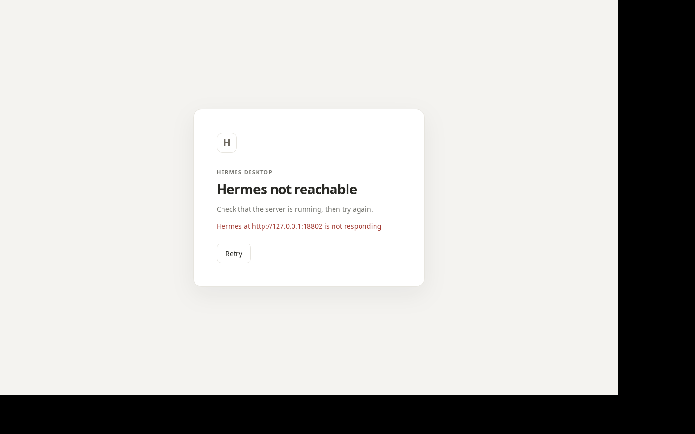
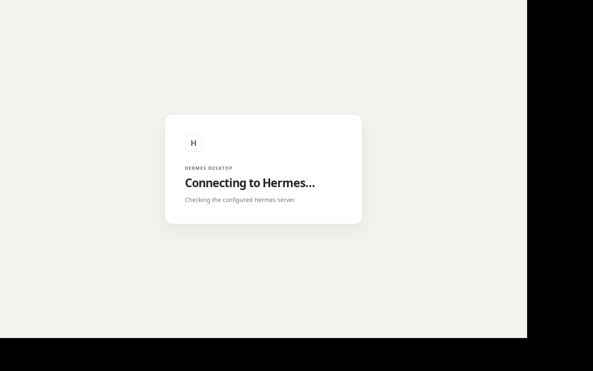
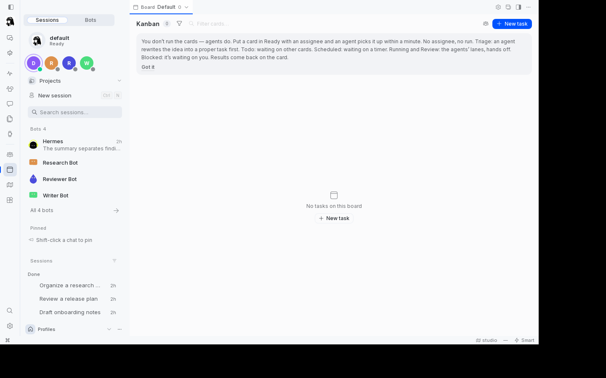
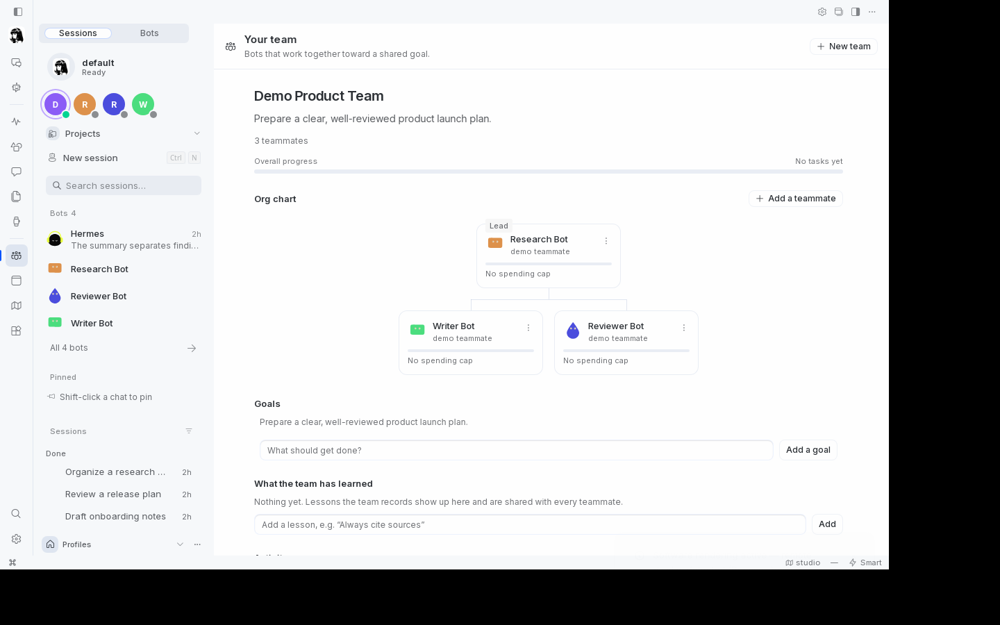
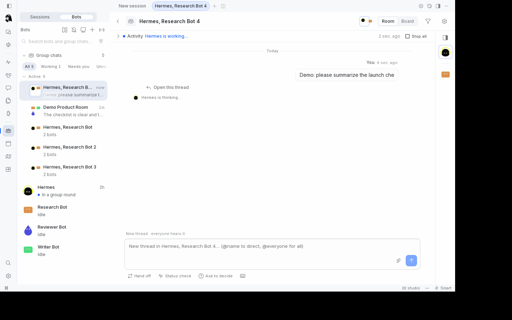
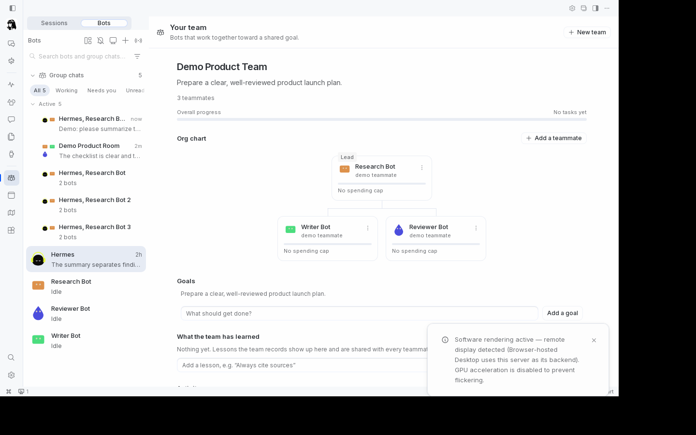
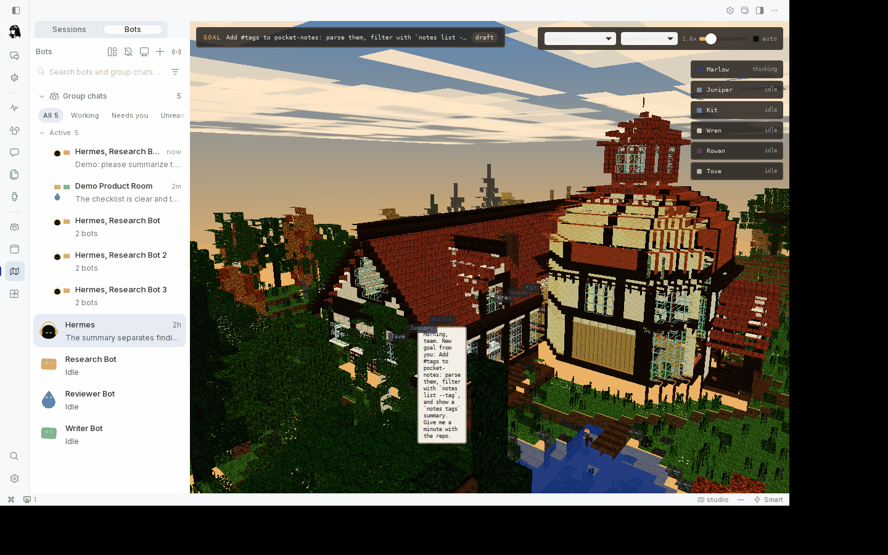

# Hermes Tauri

[](https://github.com/DECRUX9812/hermes-tauri/actions/workflows/build.yml)
[](LICENSE)

Hermes Tauri is an **optional second desktop shell alongside the Electron app, not a replacement**. It
wraps the *same* Hermes desktop web UI and uses the **Python plugin backend**: Hermes and its Python
plugins run as a sidecar process the shell starts, or as an already-running Hermes the shell attaches
to, so Python plugins keep working unchanged. It is a [Tauri v2](https://v2.tauri.app/) shell that
either attaches to a server that is already running or starts one itself, then points a system webview
at the loopback URL that server serves. Because the shell loads the same web application a browser
would, the existing plugin runtime and the web build keep working unchanged. Native behaviour (system
tray, a global toggle hotkey, notifications, a file and folder picker, `hermes-tauri://` deep links
and a signed auto-updater) is added around the webview through a small, origin-scoped command bridge.

The Electron app keeps the deep native features (botroom, HUD, pane3d, a native terminal); this shell
is the light, cross-platform option that shares the same UI and backend.


## Screenshots

The shots below were captured under Xvfb against an isolated, seeded Hermes (neutral demo data only)
by `scripts/proof.sh`; the raw PNGs are reproducible and are not committed outside `docs/screenshots/`.

| | |
|---|---|
|  |  |
| Boot page while the backend is unreachable, with Retry | The splash held in front of the window until the first painted frame |
|  |  |
| Home route after attaching: seeded session titles and recent tasks | The plugin rail on the far left, Kanban plugin open |
|  |  |
| Team page (Demo Product Team) reached by deep link | A group chat created through the UI with two demo bots |
|  |  |
| The `#/team` route after F5: the webview reloaded and kept the session | A second invocation handed the running window the `/studio` route |

## Install

**From a release.** Download the bundle for your platform from the
[releases page](https://github.com/DECRUX9812/hermes-tauri/releases): `deb`/`AppImage`/`rpm` on Linux,
`dmg` on macOS, the NSIS `-setup.exe` or `msi` on Windows (see [Platform status](#platform-status);
the macOS and Windows builds are unsigned, so Gatekeeper and SmartScreen will warn). Install the `deb` with
`sudo apt install ./Hermes\ Tauri_*.deb`, or make the AppImage executable and run it
(`chmod +x` then `./Hermes-Tauri_*.AppImage`). The deb links the distro's WebKitGTK; the AppImage
bundles the build machine's. Neither updates the `.deb`/`.rpm` in place — only the AppImage self-updates.

**From source.** See [Building on Linux](#building-on-linux).

## Usage

The shell resolves its backend in this order, first match wins: the `--url` flag, `HERMES_TAURI_URL`,
`HERMES_TAURI_CMD` (plus `HERMES_TAURI_ENV`), a `config.toml`, then a `hermes` executable on `PATH`.
With nothing configured it starts the first `hermes` it finds on `PATH` as
`hermes webapp --isolated --host 127.0.0.1 --port 0 --skip-build`. If no backend can be determined, the
boot page reports "No Hermes configured" and offers a retry.

### Attach to a running Hermes

Pass the launch link (it carries the session token) with `--url` or `HERMES_TAURI_URL`:

```sh
hermes-tauri --url "http://127.0.0.1:18800/#hermes-session=<token>"
HERMES_TAURI_URL="http://127.0.0.1:18800/#hermes-session=<token>" hermes-tauri
```

The shell stores the link mode `0600` and redacts it from logs. Attaching never adopts a production
unit and never reads the Electron spawn ledger.

### Spawn the backend yourself

`HERMES_TAURI_CMD` is a JSON array of argv; `HERMES_TAURI_ENV` adds environment. The simplest form is
the test backend command:

```sh
HERMES_TAURI_CMD="$(scripts/test-hermes.sh cmd 18810)" hermes-tauri
```

### `config.toml`

A `config.toml` in the application config directory (`$XDG_CONFIG_HOME/dev.hermes-plus.desktop/`
on Linux) configures the same sources without environment variables. Unknown keys are rejected.

```toml
# Attach to a running server (mutually usable with `command`; `url` wins).
url = "http://127.0.0.1:18800"

# Or start one. `command` is an argv array; `env` is merged into its environment.
command = ["hermes", "webapp", "--isolated", "--host", "127.0.0.1", "--port", "0", "--skip-build"]
env = { HERMES_SOMETHING = "value" }

# When attaching and the server is unreachable, start `command` instead.
spawn_if_unreachable = true

# Global toggle hotkey; omit to disable.
hotkey = "CommandOrControl+Shift+Space"
```

### Bundled payload

A payload build ships the Hermes backend (a relocatable CPython, the pinned Hermes, and `hermes_plus`)
as one archive in the resource directory. On first run the shell unpacks it into the app-data
directory, shows a "Preparing Hermes (first run)" phase on the boot page, and then spawns the bundled
launcher. Nothing the user installs lives in the payload: user state and user Python plugins go in the
per-user app-data directory via `HERMES_HOME`, so app updates replace only the immutable payload. See
[docs/python-sidecar.md](docs/python-sidecar.md).

## Platform status

Linux x86_64 is the platform this shell was developed and proven on by hand. Windows and macOS are
**CI-built**: GitHub Actions builds the app and its bundles, runs the Rust tests and a headless
launch smoke test on every push, but nobody has used those builds interactively yet. Full details,
and what is left per platform, are in [docs/platforms.md](docs/platforms.md) and
[docs/ci.md](docs/ci.md).

| Platform | Target triple | CI bundles | Status |
|---|---|---|---|
| Linux x86_64 | `x86_64-unknown-linux-gnu` | deb, appimage, rpm | Verified by hand on a dev workstation (build, attach, spawn, native overlays, rendering, Xvfb proof); CI-built and smoke-tested |
| Linux aarch64 | `aarch64-unknown-linux-gnu` | deb, appimage | CI-built and smoke-tested |
| macOS ARM64 | `aarch64-apple-darwin` | app, dmg | CI-built, tested and smoke-tested; unsigned |
| macOS x64 | `x86_64-apple-darwin` | app, dmg | CI-built (cross-compiled on ARM, not launched); unsigned |
| Windows x64 | `x86_64-pc-windows-msvc` | nsis, msi | CI-built, tested and smoke-tested; unsigned |

## Plugin settings

The shell adds **no settings screens of its own**. Plugin settings live in the UI, under **Settings >
Plugins**, and are built from each plugin's `config_schema`: Hermes renders the form, so every plugin
that works in a browser works here unchanged. Everything a Python plugin contributes (its rail page,
its tools, its settings) is served by the backend and rendered by the same web UI.

## Architecture

- `src-tauri/` — the Rust shell: window and webview, tray, global hotkey, deep links, updater, and
  the five `#[tauri::command]` entry points (`boot_state`, `boot_retry`, `native_open_external`,
  `native_notify`, `native_select_paths`).
- `crates/hermes-sidecar/` — resolves and manages the backend process: spawn or attach, health
  check, process-tree teardown, and the boot-state machine.
- `crates/hermes-shell-config/` — decides where the backend comes from (CLI flag, environment,
  `config.toml`, or a `hermes` on `PATH`) and parses deep-link URLs.
- `boot/` — the local boot page shown until the remote UI is ready; it reads state and offers a
  retry.
- `src-tauri/src/adapter.js` and `src-tauri/src/polyfills.js` — injection scripts that add the
  `hermesDesktop` bridge, the reload shortcut, and the `requestIdleCallback` shim WebKitGTK lacks.
- The Python payload is not bundled by default; the shell runs the pinned Hermes checkout.

## Quick start

You need a Linux desktop with WebKitGTK 4.1, a built `hermes-tauri` binary (see
[Building on Linux](#building-on-linux)), and a Hermes checkout that contains `hermes` and a built
`apps/desktop/dist-webapp`. The examples below use the disposable test backend and a pinned
checkout; they were run on the Linux x86_64 workstation described in
[docs/platforms.md](docs/platforms.md).

```sh
# Point the scripts at the Hermes checkout, and isolate this run's state.
export HERMES_TAURI_PIN="$PWD/../_hermes-pin"
export HERMES_TAURI_TEST_DIR=/tmp/hermes-tauri-test-demo

# 1. Start a disposable, isolated Hermes on a free port in 18800-18899.
scripts/test-hermes.sh start

# 2a. Attach the shell to it. `url` prints the private launch link, which
#     carries the session token; it is stored mode 0600 and must not be pasted
#     into logs or reports.
hermes-tauri --url "$(scripts/test-hermes.sh url)"

# 2b. Or let the shell start the backend itself. `HERMES_TAURI_CMD` is a JSON
#     array of argv, and `test-hermes.sh cmd` prints exactly that.
HERMES_TAURI_CMD="$(scripts/test-hermes.sh cmd 18810)" hermes-tauri

# 3. Stop the test server (a spawned backend is stopped when the shell exits).
scripts/test-hermes.sh stop
```

## Building on Linux

Building uses the container builder image, which carries the GTK/WebKitGTK `-dev` headers,
`cargo`, and `tauri-cli`. It mounts the working tree and a shared cargo/target cache and
serializes runs with a build lock.

```sh
# One-time: build the builder image.
scripts/builder.sh --init

# Build the app and bundles inside the image.
scripts/builder.sh cargo tauri build --bundles deb,appimage

# Faster inner loop for an un-bundled binary.
scripts/builder.sh cargo build --release
```

Outside the container, a plain `cargo build --release` from the repository root produces
`target/release/hermes-tauri` if the host already has the Tauri Linux dependencies listed in
[docs/ci.md](docs/ci.md). The CI build matrix and the exact target/bundle matrix are documented
there too.

## Test Hermes, proof, and measurement scripts

- `scripts/test-hermes.sh` — starts, checks, and stops a disposable Hermes with neutral demo data,
  isolated under `/tmp/hermes-tauri-test*` and restricted to ports 18800-18899. `status`, `url`,
  `cmd`, `reset`, and `verify-isolation` are the other subcommands; see
  [docs/test-hermes.md](docs/test-hermes.md).
- `scripts/proof.sh` — one lock-free driver that starts a disposable Hermes, re-executes itself under
  a private D-Bus session and Xvfb, drives the shell with real input, and writes the screenshots in
  [docs/proof.md](docs/proof.md).
- `scripts/measure.sh` — size, idle RAM, and window-startup measurements. The harness and results
  are in [docs/measurements.md](docs/measurements.md).
- `scripts/webkit-smoke.mjs` and `scripts/webkitgtk-smoke.py` — render the boot, home, team,
  kanban, studio, and settings routes under WebKitGTK and Chromium and diff console/page errors;
  see [docs/webkit-compat.md](docs/webkit-compat.md).
- `scripts/proof.sh` — the end-to-end Xvfb proof: starts a disposable Hermes, drives the shell with
  real input (xdotool keys and clicks plus the shell's own deep links) and writes nine verified
  screenshots plus two checks. `--spawn-shutdown` proves the spawned backend dies with the shell.
  See [docs/proof.md](docs/proof.md).
- [docs/proof.md](docs/proof.md) — the screenshot proof, the image list and how to reproduce it.

For headless runs, wrap the GUI command so WebKit gets a display and a private session bus:

```sh
dbus-run-session -- xvfb-run -a -s "-screen 0 1440x900x24" hermes-tauri --url "$(scripts/test-hermes.sh url)"
```

The shell keeps its own boot page in a second, always-on-top window (the splash) until the app's page
reports its first painted frame, so the window is never a flat blank colour while the app's JavaScript
bundle executes. The splash is removed by the app's first frame, by a failed start (the main window
then shows the same boot page with Retry) or by a 30 s cap, whichever comes first.

## Native features and their web fallbacks

The shell overlays a `window.hermesDesktop` bridge on HTTP(S) pages. When the same UI is served to
a plain browser, each call degrades to the browser's own mechanism.

| Capability | Hermes Tauri shell | Browser fallback |
|---|---|---|
| Notifications | `native_notify` shows an OS notification | Notifications API (permission gated) |
| Open a link externally | `native_open_external` opens the system browser | `window.open` / anchor |
| File and folder picker | `native_select_paths` opens a native dialog | `<input type="file">` |
| System tray | Menu: Show / Hide / New chat / Quit; an "Install update and restart" item appears when an update is found | none |
| Global toggle hotkey | `CommandOrControl+Shift+Space` hides or shows the window (X11 only, see below) | none |
| Deep links | `hermes-tauri://open?path=/team` routes to Home, Team, Kanban, Studio, or Settings | in-app hash routes |
| Reload | The injected adapter maps `F5` and `Ctrl`/`Cmd`+`R` to `location.reload()` (WebKitGTK has no default) | browser default |
| Auto-update | Signed updates via the tray, behind an update feed and public key | browser reload |
| Window model | One main window plus guarded preview popups; closing hides to the tray | browser tabs |

## Security model

- **Navigation guard.** The main webview may load only the bundled boot page or the exact backend
  origin. Any other HTTP(S) navigation is opened in the system browser instead of the app, and
  non-HTTP schemes are dropped. Preview windows (same-origin `window.open`, including `blob:`
  previews) carry the same navigation and new-window guards.
- **Origin-scoped capability.** The backend origin is unknown at build time when the shell spawns a
  server, so the runtime grants a single capability (`hermes-backend`) to that exact origin on the
  `main` window only, exposing just `native_open_external`, `native_notify`, and
  `native_select_paths`. The bootstrap capability (`boot-local`) is `local` and limited to
  `boot_state`, `boot_retry`, and `core:event:allow-listen`. The frontend gets no plugin
  permissions.
- **Command allow-list.** `native_open_external` accepts only `http`/`https` URLs with a host and no
  embedded credentials. Deep links are parsed strictly: `hermes-tauri://open?path=…` with a single
  `path` key, one percent-decode step, and a whitelist of five routes; traversal, backslashes,
  control characters, extra keys, and fragments are rejected.
- **Content Security Policy.** The app pins `default-src 'self'; script-src 'self'; style-src
  'self'; connect-src ipc: http://ipc.localhost`. The main window and preview windows are created
  from Rust with the guard attached.
- **Launch secrets.** Attach-mode launch links carry a session token; the shell stores them mode
  `0600` and redacts them from logs.

### Known limitations

- The sidecar runs in its own process group and is killed with the process group on exit; a
  theoretical reuse of a process-group id could signal an unrelated process (R1 #5).
- On Windows, the Job Object is assigned immediately after spawn, so a grandchild spawned in that
  brief window could escape it (R1 #7, [docs/platforms.md](docs/platforms.md)).
- The auto-updater verifies the signature over the payload, but the version string in the update
  manifest is not covered by that signature (R2 L3).
- The Python payload resolves Starlette 0.52.1, which is below the `1.0.1` version pinned for
  CVE-2026-48710: `hermes_plus` requires `starlette<1`. This is a recorded trade-off, see
  [docs/python-sidecar.md](docs/python-sidecar.md).
- Group-chat rooms do not hydrate from the server mirror in a fresh profile (a UI boot race,
  described in [docs/test-hermes.md](docs/test-hermes.md)). The proof therefore creates a room
  through the UI and types one neutral message into it, instead of showing the seeded room.
- The splash and the main window share a title and a size. Under a tiling Wayland compositor the
  compositor may place them side by side rather than stacked ([docs/platforms.md](docs/platforms.md)).
- The global hotkey needs X11 or a focused XWayland window; native Wayland is not supported by the
  upstream crate ([docs/platforms.md](docs/platforms.md)).

## License

Hermes Tauri is [MIT](LICENSE) licensed. Copyright (c) 2026 DECRUX9812.

The bundled payload carries third-party code under its own licenses: the relocatable CPython is
PSF-2.0; the pinned Hermes agent is MIT (Copyright (c) 2025 Nous Research); `hermes_plus` is MIT; and
the remaining Python dependencies in the payload are permissive (MIT, BSD and Apache-2.0). A release
that ships the payload reproduces those `LICENSE` files inside the payload tree. The Rust dependency
tree is permissive as well: every crate is MIT or Apache-2.0 (a few are MPL-2.0, Zlib, BSD, ISC,
Unicode-3.0 or Unlicense, and the only LGPL option is a dual-licensed `OR` choice we take as MIT); no
dependency is GPL/AGPL, and no dependency omits a license. `cargo metadata --locked` summarises this
tree.

## Documentation

- [docs/platforms.md](docs/platforms.md) — per-platform status and behaviour.
- [docs/ci.md](docs/ci.md) — the build/release workflow and the artifact matrix.
- [docs/measurements.md](docs/measurements.md) — size, RAM, and startup measurements.
- [docs/proof.md](docs/proof.md) — screenshot proof.
- [docs/webkit-compat.md](docs/webkit-compat.md) — WebKitGTK compatibility audit.
- [docs/test-hermes.md](docs/test-hermes.md) — the disposable test backend.
- [docs/python-sidecar.md](docs/python-sidecar.md) — packaging the Python payload.
